# The Nature and Origins of Mass Opinion

<!-- markdownlint-disable MD033 -->

## Information, predispositions, and opinion

Claim: Elites supply political arguments; citizens' values, interests, and group
loyalties filter which ones they accept.

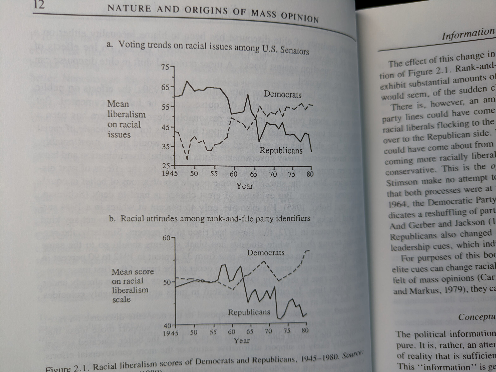

The figure addresses partisan sorting (elite driven), not the larger rise in
racial liberalism that Zaller describes just before it. Sorting is a
'conservation of mass' kind of theory: the parties move apart as people
redistribute between them without any change in the national mean. Three
things: 1. figure is misleading as it elides over the fact that the scales mean
diff. things across years, 2. what's the theory of why elites changed, and 3.
it wasn't clear to me if this was an "impulse response" model and what explained the timelines.

## The Receive-Accept-Sample model

What gets stored:

1. `Receive = f(exposure, attention, comprehension)`

   Some GS work here:

   Exposure = f(message supply, targeting, media choice, social networks, self-selection)
   Attention = f(issue-specific interest, salience, motivation, identity relevance)
   Comprehension = f(relevant prior knowledge, message complexity, cognitive ability)

2. `Accept/resist = f(predispositions × awareness)`

   But also argument quality, source credibility, strength and coherence of prior beliefs, ideological organization, numeracy, etc.

3. `Retention = largely unspecified`

   A received and accepted consideration may be forgotten, reinforced, or displaced. Retention should depend on encoding, repetition, elapsed time, reinforcement, interference, and importance.

What gets retrieved from the 'store'

4. `Sample/retrieve = f(accessibility)`

   P(retrieve j at t) = f(memory strength, accessibility, cues, ideology/identity)?

5. `Response = average/balance of sampled considerations`

   But priming is partly about weighting, right?

One way to think about z: a person holds a pool of considerations with a beta
and a sigma. Reception and resistance change the pool; accessibility changes
what gets sampled. The response averages the sample. (The elicitation process
crystallizes the attitude?)

But unstable answers could reflect conflict in the pool, changing accessibility,
or response noise. Can't recover beta/sigma without knowing the sampling and
response rules.

McGuire: self-esteem, intelligence, freedom from anxiety --- all have non-monotonic corr. w/ persuasion.
Explanation = positive with reception but negative with acceptance given reception. Didn't get if Zaller
believes in the same variables as McGuire or diff. variables that explain exposure and acceptance.

## Response instability

Table 2.1 uses a two-wave panel of the same NES respondents interviewed in
January and June 1980. Many changed answers during those five months.

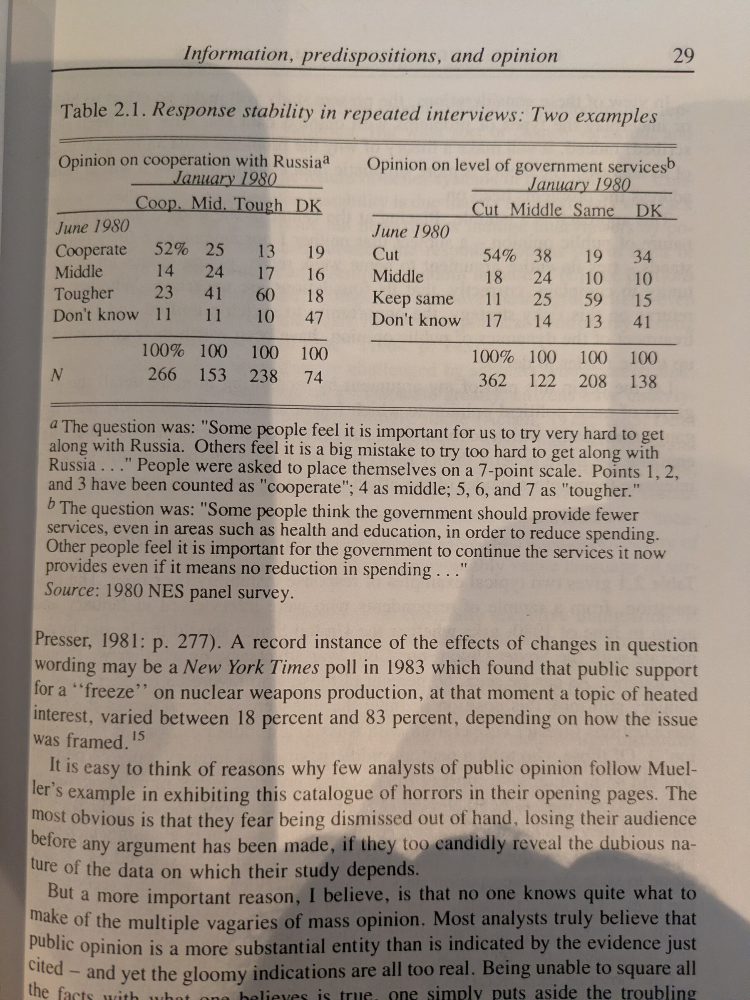

## Stop-and-think about stop-and-think

Exp: One group answered a policy question and then explained its answer. The
other group had to consider each side separately before answering. The latter
procedure is better described as forced bilateral elaboration than as 'stop and
think.'

The treatment may reveal thoughts that were already accessible, retrieve
thoughts that were dormant, or induce new thoughts.

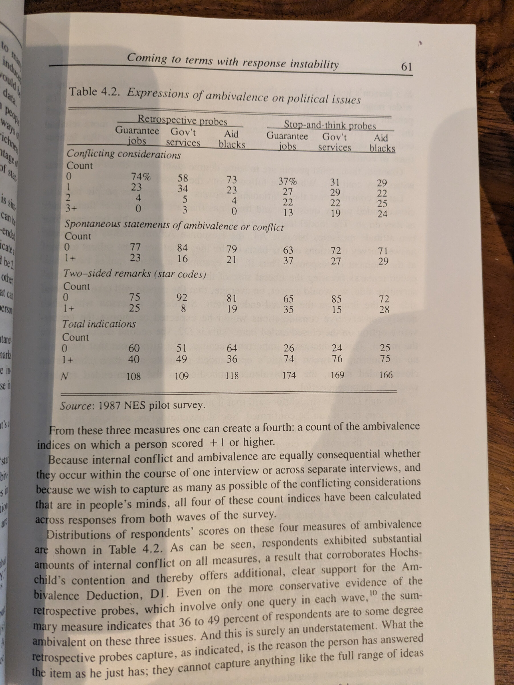

The treatment produces far more expressions of conflict.
Interpretation? Many respondents can retrieve or produce considerations
on both sides when asked to search for them.

### Sniderman, Sniderman

In the stop-and-think condition, 63% of respondents on jobs, 69% on
government services, and 71% on aid to Black people produced at least one
consideration on each side. A broader measure classified roughly 75% as at least
somewhat conflicted. Zaller and Feldman call this "clear initial support" for
the ambivalence axiom. But the evidence shows only that respondents can produce
counterarguments when explicitly prompted to search both sides—not that those
arguments seriously compete. Applying the lenient criterion of at least twice as
many considerations on one side, 61.7% (aid to Black people), 52.3% (jobs), and
61.4% (services) of the nominally conflicted stop-and-think respondents were
one-sided. About one in three had at least four times as many remarks on one
side.

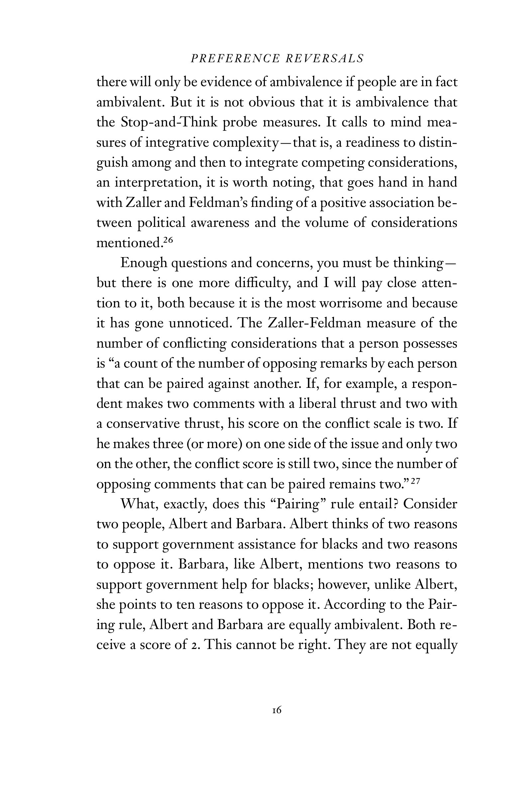

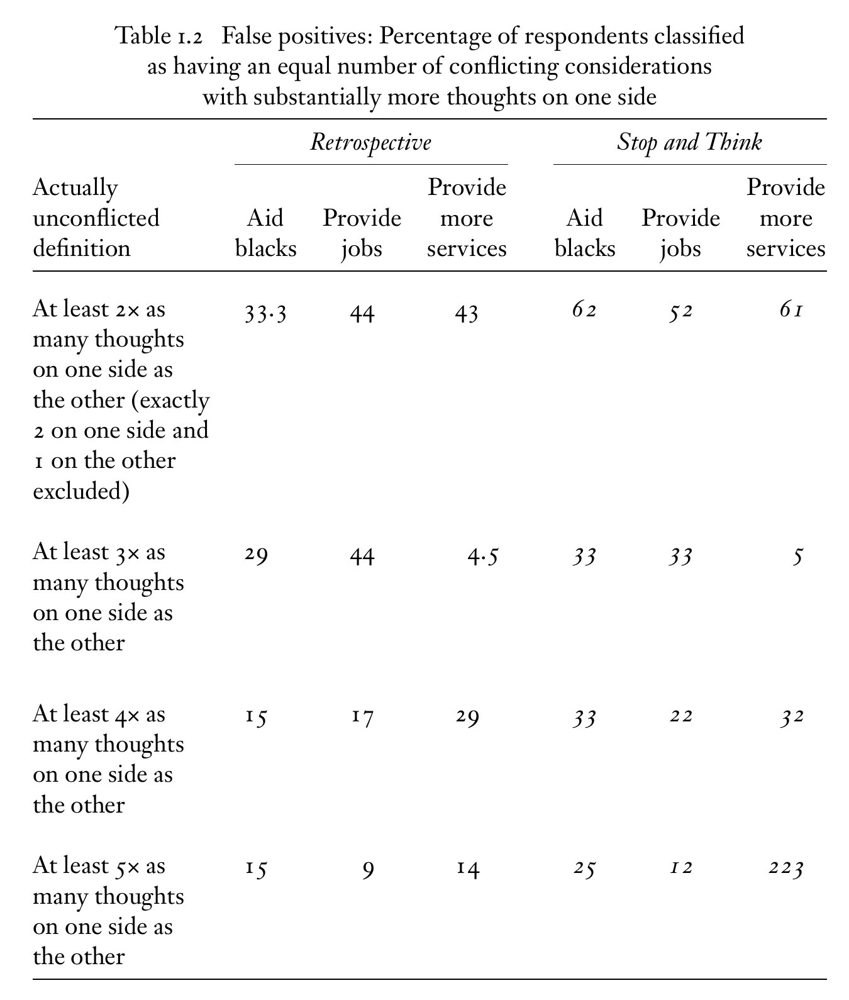

Related:

- Gelman, [A coding problem in the classic study, Nature and Origins of Mass
  Opinion](https://statmodeling.stat.columbia.edu/2018/04/30/coding-problem-classic-study-nature-origins-mass-opinion/),
  Statistical Modeling blog, 30 April 2018.

  From the brief review quoted there: "What is more startling and sobering is
  that something regularly taught in graduate courses and so well cited is so
  under-scrutinized and so underthought. The citation/scrutiny ratio is pretty
  high. And tells a bunch about biases of academics and chances of scientific
  progress. It is a strange fate to be cited but not be scrutinized."

## Response Stability

Table 4.5 is plausibly there to test if accessibility causes responses conditional on the same pool of considerations (same beta/sigma) but the regression being run:

`answer2 = b0 + b1 answer1 + b2 considerations1 + b3 considerations2 + error`

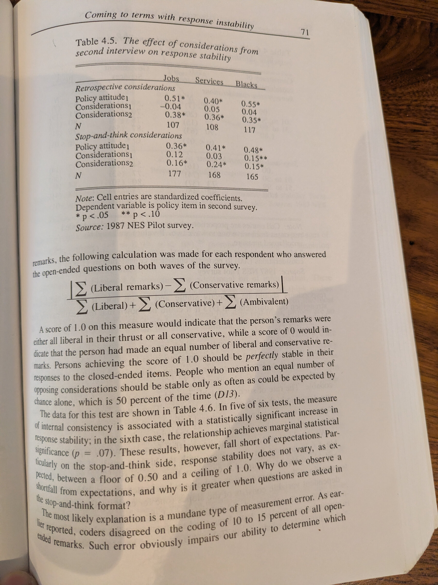

We could randomly make one of the considerations that have been elicited before accessible to test if accessibility causes reported attitudes?

Table 4.6 shows that respondents with more consistently one-sided considerations
generally give more stable policy answers across interviews.

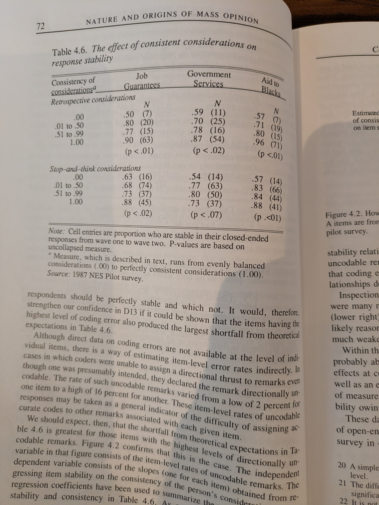

But are the reported considerations actually mediating the formation of the answer?

Zaller attributes the weaker consistency-stability relationship in the stop-and-think condition to coding error.
[Figure 4.2](../src/75_zaller_nature_origins_mass_opinion/ch04_figure_4_2_uncodable_remarks.jpg)

But it contains only six issue-by-form observations, and the two survey forms
occupy different parts of the graph.

## Awareness and resistance

Table 5.2: Stop-and-think strengthens the ideology-answer link among highly
aware respondents. (The 95% CI is pretty big.)

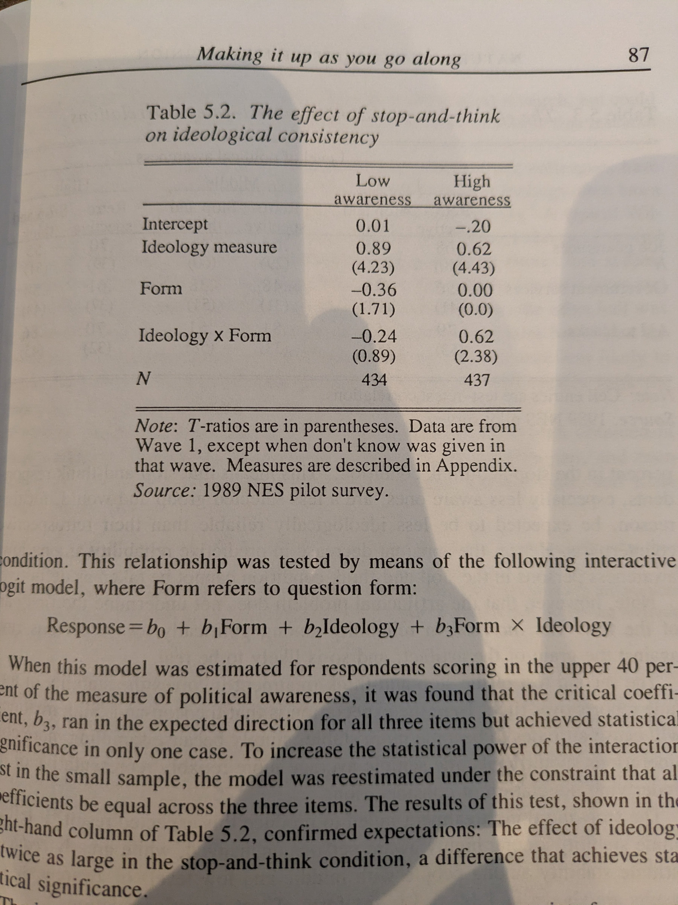

[Zaller's interaction model and discussion of Table 5.2](../src/75_zaller_nature_origins_mass_opinion/ch05_table_5_2_interaction_model.jpg).

Table 5.3: Stop-and-think lowers test-retest correlations in most cells.
More thought doesn't necessarily produce a more stable answer.

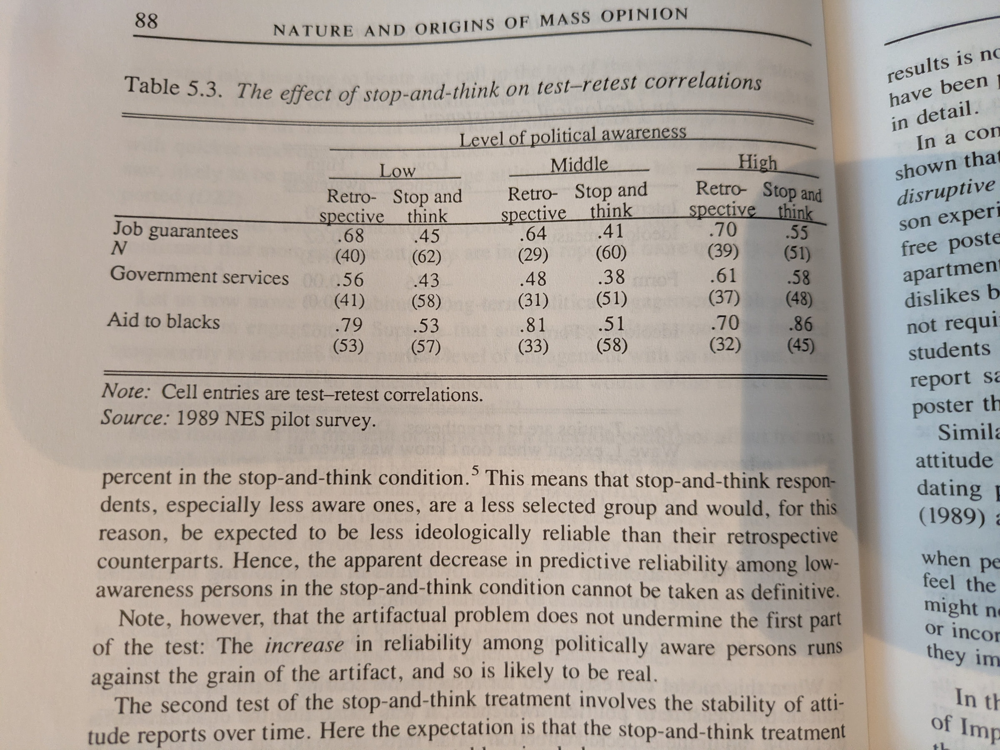

Highly aware respondents give more ideologically consistent considerations.
Negative Iran-Contra remarks rise with awareness among Democrats, but are
roughly flat among Republicans (Table 8.3).

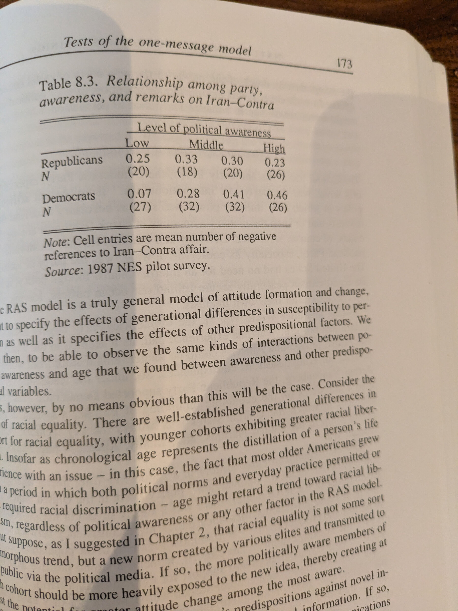

But no negative remark could mean no exposure, no recall, rejection, or reluctance
to say it. How do we isolate resistance? Remark counts also depend on fluency and
how much people say; awareness bundles education, interest, ideology, and exposure.

## Opinion change and the structural model

Central America, before/after Iran-Contra: awareness predicts both reception
and acceptance; hawkishness and Reagan approval also predict acceptance.

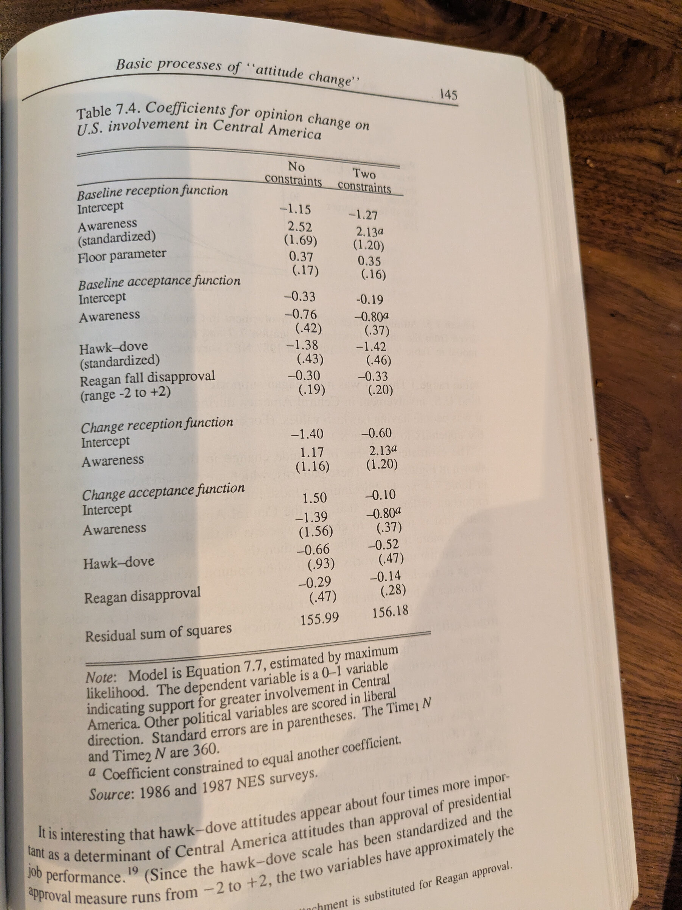

[Estimation appendix: maximum likelihood via nonlinear least squares](../src/75_zaller_nature_origins_mass_opinion/ch07_appendix_maximum_likelihood_via_nls.jpg).

- Only support is observed. Low reception/high acceptance can resemble high
  reception/low acceptance. Separating them rests on functional form, predictors,
  and restrictions across periods.
- Large SEs in the unconstrained change model; restrictions stabilize estimates
  with little loss of fit. How much identification comes from the restrictions?
- Same respondents twice, but individual transitions aren't the outcome.
  No untreated group either. Why attribute the change to Iran-Contra?

The conversion rates divide net predicted change by initial nonsupport:
.79 → .89 becomes .10/.21 ≈ 48%; .35 → .46 becomes .11/.65 ≈ 17%.
Similar absolute changes, very different conversion rates. These aren't observed
individual conversions; opposite movements can cancel.

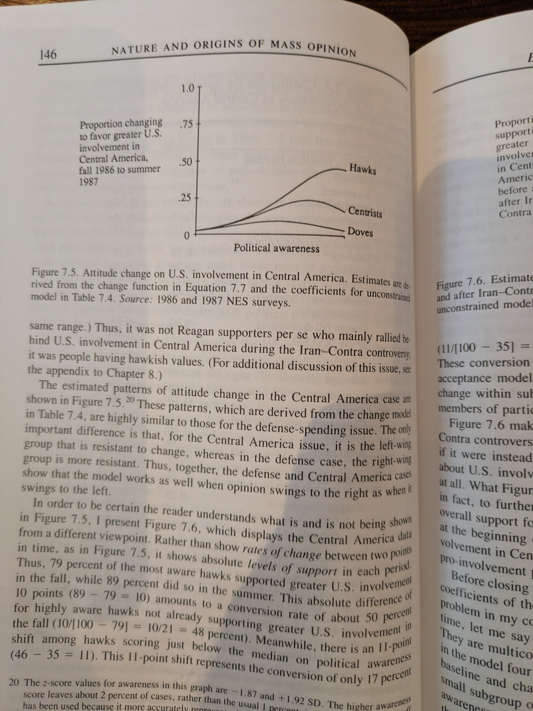

Figure 7.6: Hawks move; doves remain near a floor. Divergence, but little evidence
of symmetric movement away from the center.

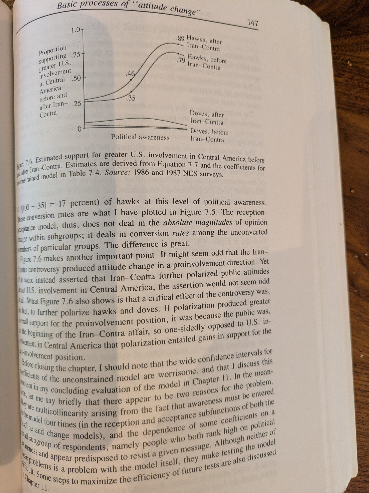

## Two-sided information flows (ch. 9)

Figure 9.1: Antiwar magazine stories rise from 1964 to 1970; prowar stories peak
in 1966, then fall. Total Vietnam coverage in the NYT index keeps rising.
Amount of information and balance of arguments are different things.

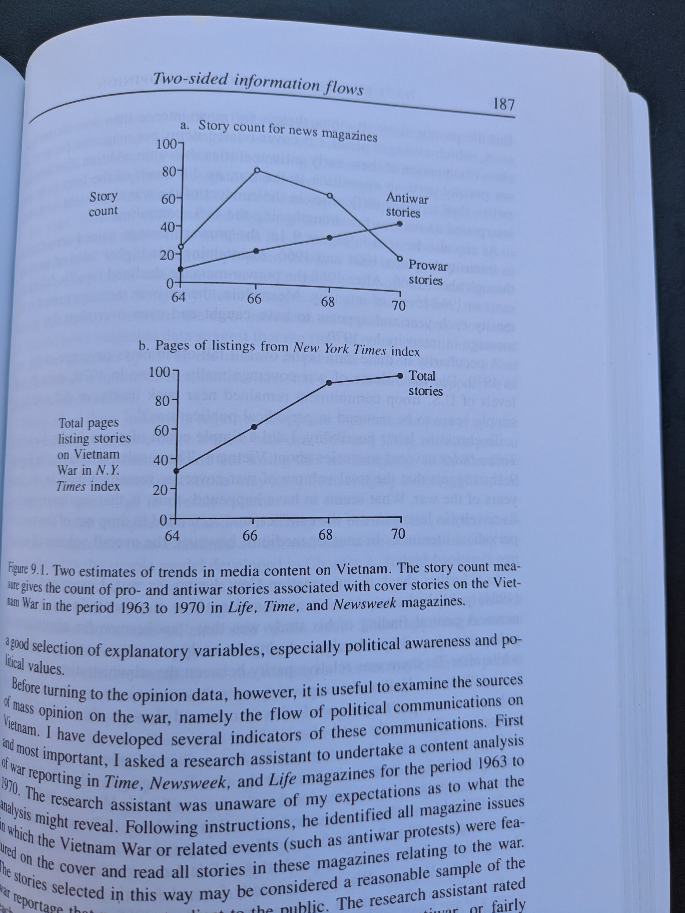

### IV by wishful thinking?

Table 9.2 predicts a five-item hawk–dove scale using religion, church attendance,
civil-rights views, region, and union membership (1988 NES; N = 1,441;
adjusted R² = .14).

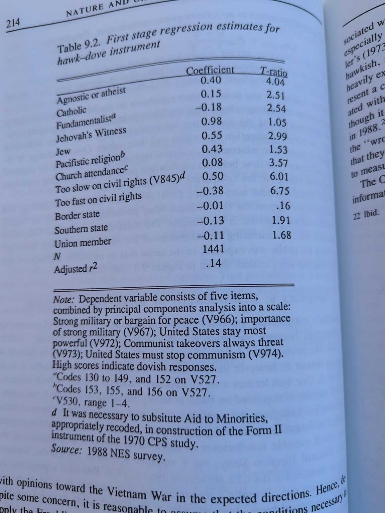

So civil-rights views and religion become an instrument for hawkishness?
Where is the exclusion restriction? These could affect Vietnam opinions through
party loyalties, elite cues, or social networks even holding hawkishness fixed.
Predicting hawkishness doesn't make those other paths disappear.

## Campaign information and electoral choice

Figure 10.3: Opposition voters become more pro-incumbent through the first four
awareness categories, then turn toward their party's challenger in the fifth,
especially in intense races. Fits reception-resistance, but the reversal rests
on that last bin. The decisive high-awareness, intense-race cell has ~49 people.

Outcome:

`incumbent likes + challenger dislikes - incumbent dislikes - challenger likes`

- Sparse counts, small cell, no confidence intervals. Does the reversal survive
  different bins or a continuous awareness measure?
- Intense races have different candidates, spending, coverage, and electorates.
  Aware voters may notice those differences. Campaign intensity isn't randomly
  assigned information.
- Figure 10.4 decomposes the same score; it doesn't independently test the
  mechanism. Figure 10.5's smooth curves come from the fitted interaction model.
- One favorable thought and five favorable/four unfavorable thoughts both
  score +1. Where did ambivalence go?
- Part I treats mentions as samples of accessible thoughts. Here they stand in
  for what campaigns put into memory. Need to separate acquisition from recall
  and construction during the interview.

## Elite discourse

Elite/media frames change: Vietnam as containment → civil war; Newsweek defense
coverage as military weakness → cost overruns after Reagan's election; more
civil-rights framing of homosexuality in 1970s network news.

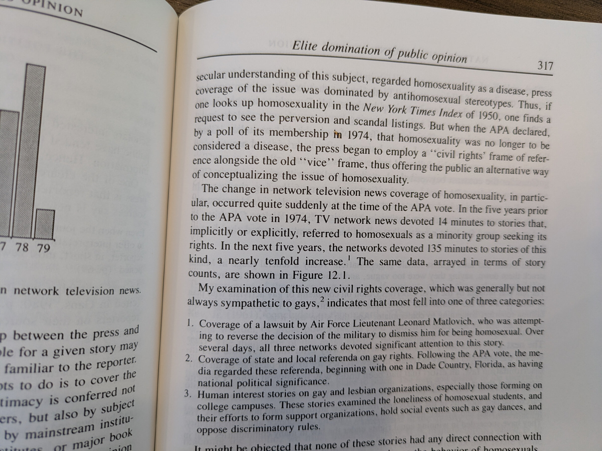

But changing frames don't establish elite → public causation. Need denominators,
comparison series, and a way to rule out broader changes affecting both.

### How change happens (ch. 12)

Same mechanism as the earlier account of declining anti-Black prejudice
(ch. 2, pp. 9–10). Zaller follows Myrdal: scientists discredit racial hierarchy →
white attitudes change → material conditions improve. He locates the initial
shift in "purely intellectual developments." Example: Carl Brigham endorses
racial hierarchy in 1923, then retracts the conclusion in 1930.
([p. 10](../src/75_zaller_nature_origins_mass_opinion/ch02_myrdal_science_and_racial_attitudes.jpg))

The strong claim: with racist elites, efforts to mobilize white support for
Black equality "were bound to fail."
([Earlier passage](../src/75_zaller_nature_origins_mass_opinion/ch02_elite_racial_attitudes_before_1930.jpg))
Expert change becomes a prerequisite for successful mobilization. But could
mobilization also change the experts?

Experts change which views count as legitimate → the press changes its frames →
citizens encounter different considerations. Zaller puts experts upstream of the
press:

> "the press undertakes, in general, to cover the news from all legitimate points
> of view, where legitimacy is determined by what mainstream experts take
> seriously." ([p. 319](../src/75_zaller_nature_origins_mass_opinion/ch12_p319_experts_news_legitimacy.jpg))

The next question is why experts change. Zaller calls for studying "the politics
of expert communities": how they generate and spread claims, how open they are
to challenge, and their ideological diversity (p. 319). This is a research
agenda, not yet an explanation of where the new ideas come from.

Gay-rights example:

- Around the 1974 APA membership vote, network coverage using a civil-rights
  frame rises from 14 minutes in the preceding five years to 135 in the next
  five. Much concerns Leonard Matlovich's military dismissal, referenda, and
  campus organizations. Civil-rights framing doesn't always mean sympathetic
  coverage. ([p. 317](../src/75_zaller_nature_origins_mass_opinion/ch12_p317_apa_vote_civil_rights_coverage.jpg))
- Cronkite, June 1972: "They'll apparently give the fashion reporters something
  to contemplate." May 1974: gay people organizing for acceptance and equal
  rights. Ridicule → rights.
  ([p. 318](../src/75_zaller_nature_origins_mass_opinion/ch12_p318_cronkite_expert_authority.jpg))
- Jerry Brown, Reagan, and Carter oppose California's 1978 initiative targeting
  gay schoolteachers. Zaller reads this as another consequence of the changed
  expert climate (pp. 318–319).

The causal leap: the new view "clearly originated among psychiatric experts";
"much else followed more or less automatically" (p. 318). But activism could
change both experts and coverage. His own sympathetic campus-news example aired
in April 1973 (p. 317, n. 3), before the 1974 vote. The vote isn't a clean start
date for the new frame.

## Assessment

Survey answers depend on information and question context. Does RAS uniquely
explain that? Different mechanisms can produce the same answers.

Test: Elicit pro/con considerations beforehand, then randomly cue one of the
respondent's own prior considerations without adding information. Does the answer
move with the cue, especially among people who previously gave both sides?
Does the effect decay as the cue recedes?

<!-- markdownlint-enable MD033 -->
