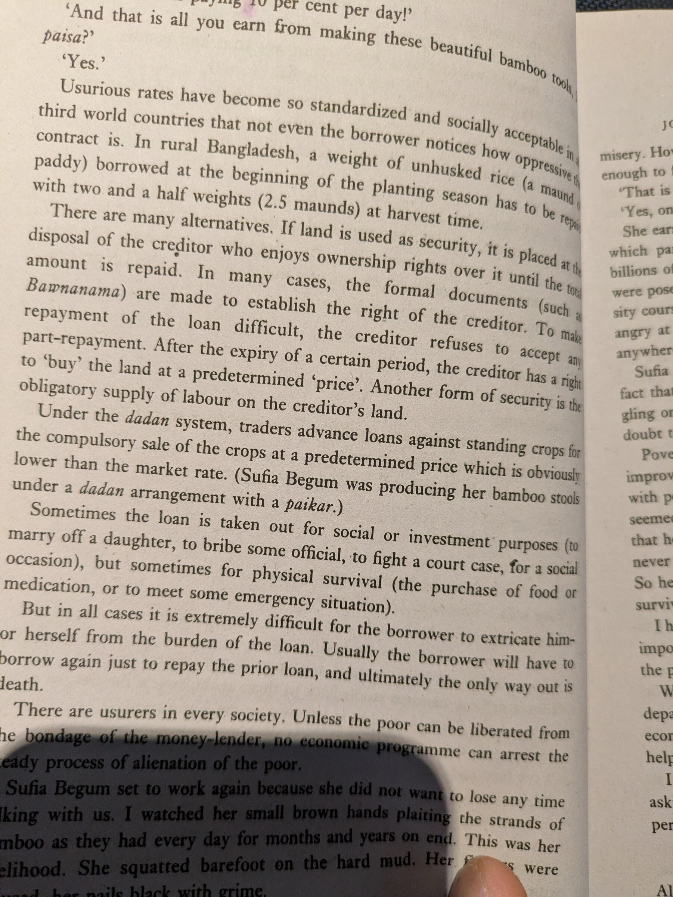
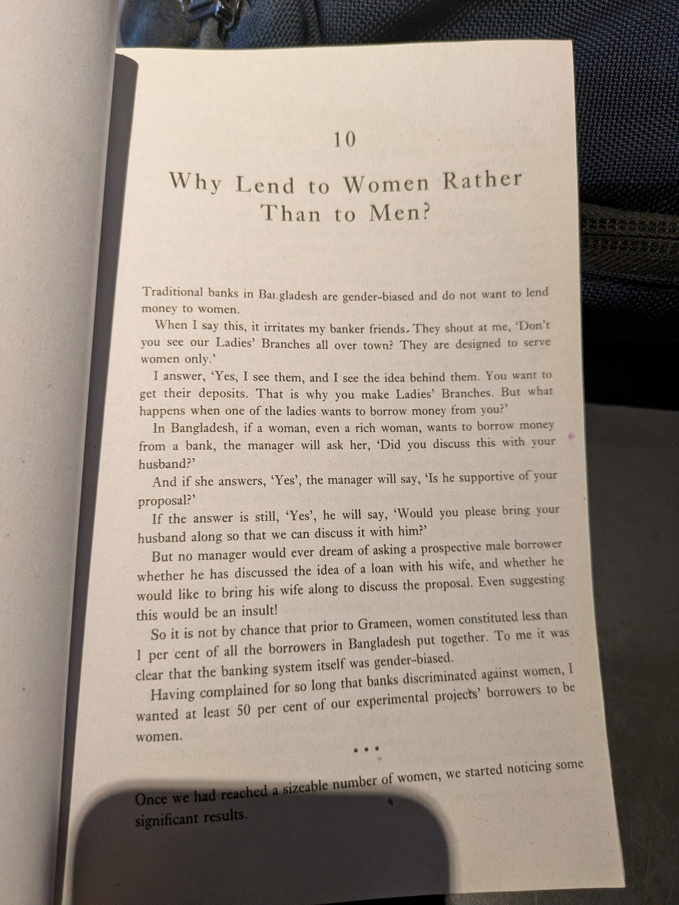
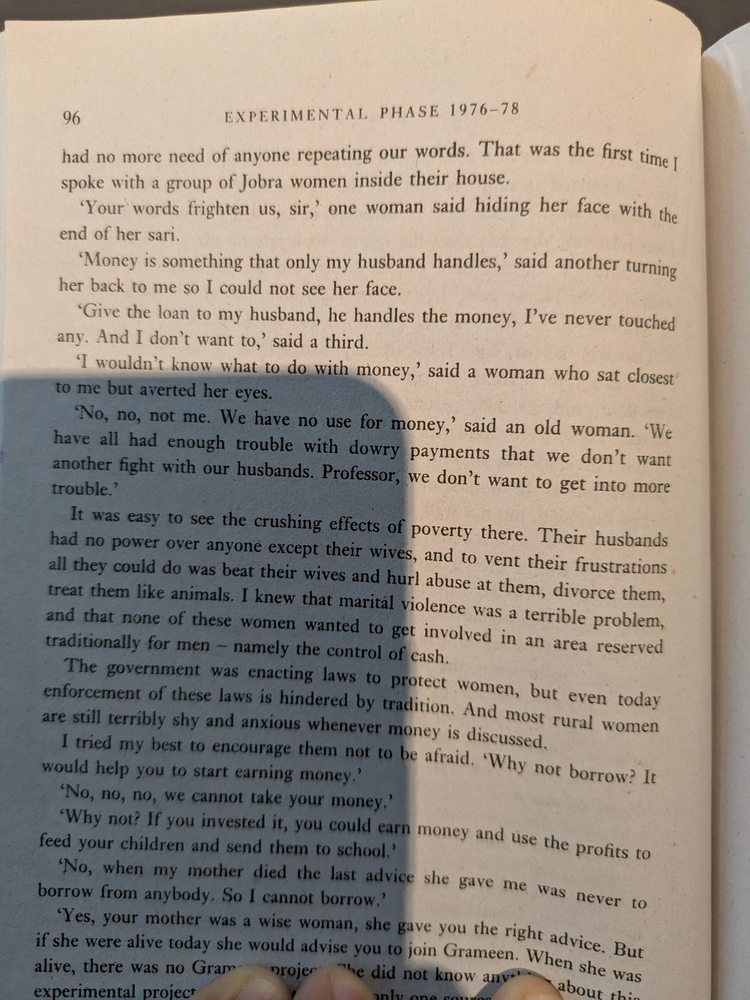
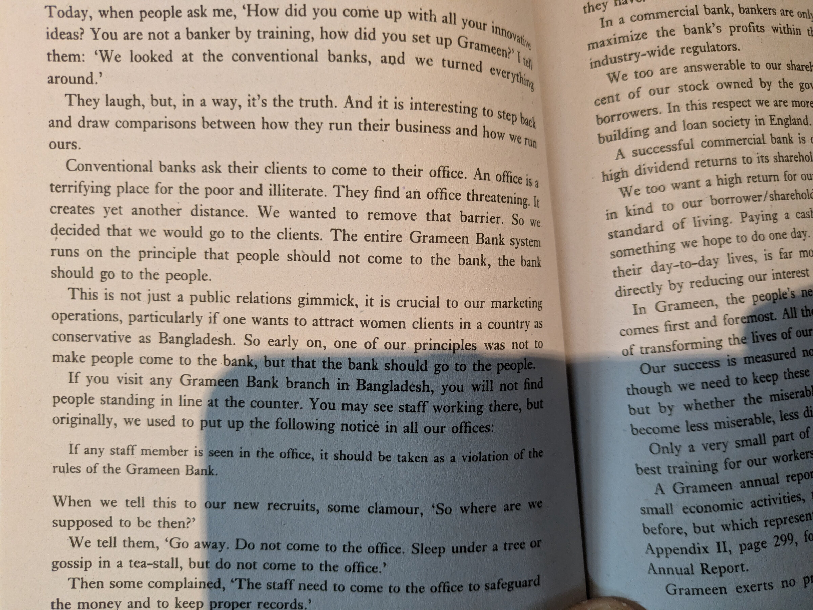
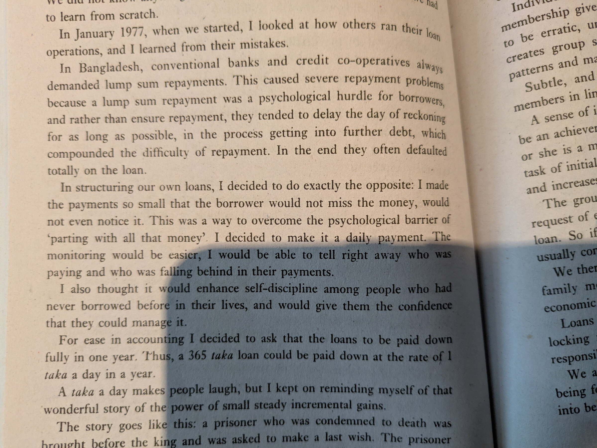
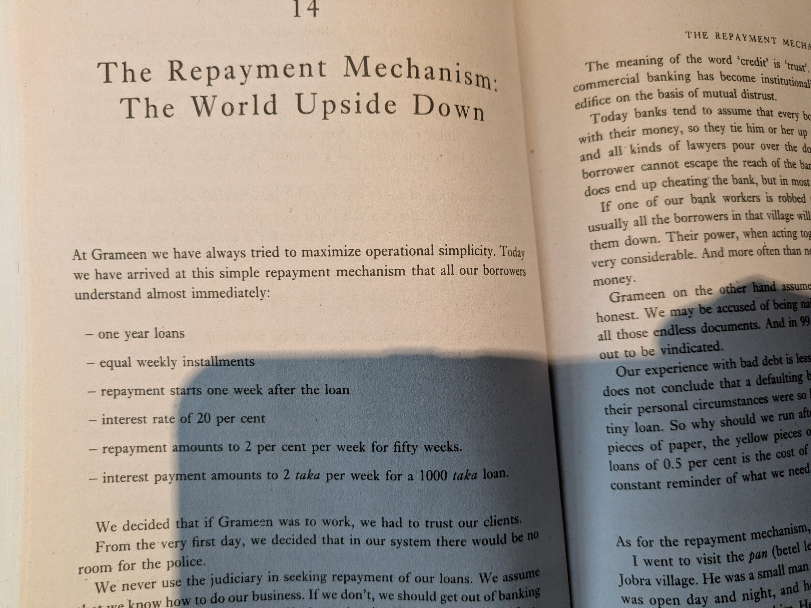
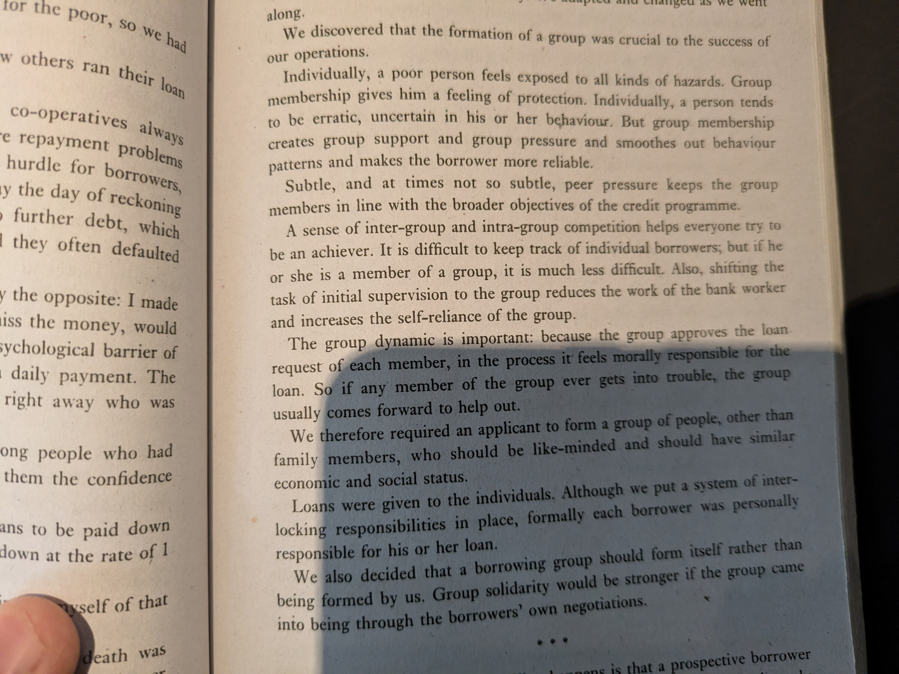
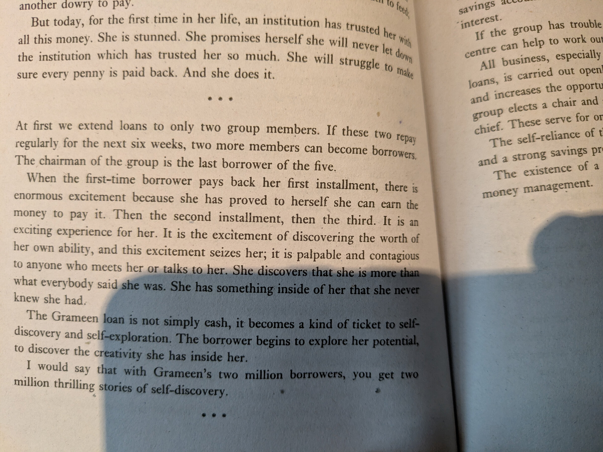
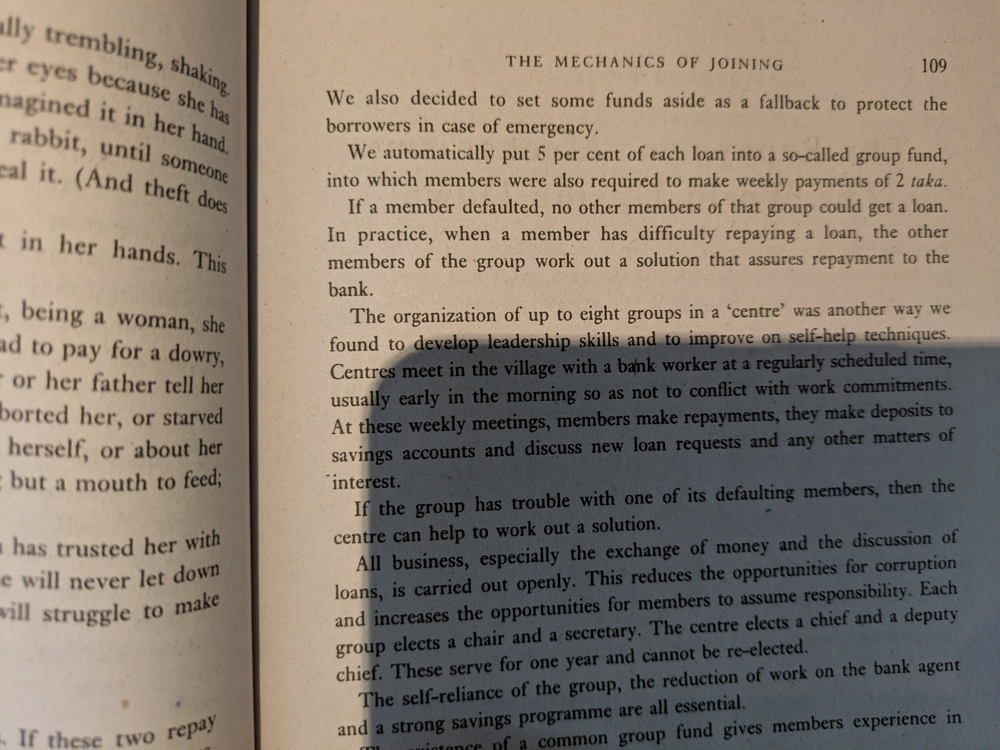

## Banker to the Poor

Yunus's account of founding the Grameen Bank. Asked how a non-banker designed
it: "We looked at the conventional banks, and we turned everything around."

### Why the poor don't borrow from banks

- Usury is so standardized that borrowers don't notice it: a maund of rice
  borrowed at planting is repaid with 2.5 maunds at harvest. Under the _dadan_
  system, traders lend against standing crops in exchange for selling the crop
  to them below the market price. The borrower usually borrows again to repay,
  "and ultimately the only way out is death."

- Banks discriminate against women. A woman, even a rich one, is asked whether
  she discussed the loan with her husband; no man is asked about his wife.
  Before Grameen, women were under 1 percent of borrowers in Bangladesh.
  Grameen aimed for at least half.
- The women themselves at first refused: "Money is something that only my
  husband handles."

### The design

- **The bank goes to the people.** Offices terrify the poor and illiterate, so
  Grameen staff visit borrowers. Offices once carried the notice: "If any staff
  member is seen in the office, it should be taken as a violation of the rules
  of the Grameen Bank."

- **Small, frequent repayments.** Lump-sum repayment is a psychological hurdle:
  borrowers delay, borrow more and default. Yunus started with daily payments
  so small the borrower would not miss the money (a 365 _taka_ loan repaid at
  1 _taka_ a day), which also showed at once who was falling behind.
- **Simple terms**, later standardized as: one-year loans; equal weekly
  installments, starting a week after the loan; 20 percent interest; 2 percent
  of the principal a week for fifty weeks; 2 _taka_ of interest a week on a
  1,000 _taka_ loan.
- **No police, no courts.** Grameen assumes borrowers are honest and does not
  use the judiciary to collect.

- **Groups of five.** Group membership protects the individual, smooths
  erratic behavior and adds peer pressure, and it moves first-line supervision
  from the bank worker to the group.
- **Staggered loans.** Two members borrow first; if they repay for six weeks,
  two more can borrow; the group's chair borrows last.
- **Shared stakes.** 5 percent of each loan goes into a group fund, plus 2
  _taka_ a week from each member. If a member defaults, no one else in the
  group can borrow, so in practice the others work out a solution.
- **Centres.** Up to eight groups meet a bank worker weekly, early in the
  morning, to repay, save and discuss new loans. All money changes hands in
  the open, to limit corruption. Groups elect a chair and secretary, centres a
  chief and deputy, each for one year and not re-electable.

