## Factfulness

Hans Rosling (with Ola Rosling and Anna Rosling Rönnlund) argues that educated
audiences systematically misjudge basic global facts—scoring worse than random
guessing on three-choice questions about poverty, vaccination, female education,
and demographic growth—because they rely on an outdated 1960s binary mental
model ("developed" versus "developing") reinforced by ten cognitive instincts.

Beyond its substantive claims about global development, the book is a masterclass
in **belief-updating visualization**: how to design statistical graphics when the
reader arrives with a strong prior misconception.

---

### Visualization & Rhetorical Techniques

#### 1. The "Confirm-Then-Disconfirm" Frozen-Frame Trap

When readers hold a binary prior ("us versus them," "developing versus
developed"), showing current data alone rarely dislodges the taxonomy—readers
simply mentally redraw the boundary through the new cloud. Rosling instead uses
a two-step visual trap:

1. **Confirm the prior with an undated baseline (p. 27):** Plot _Children
   surviving to age 5_ against _Babies per woman_ (with the horizontal axis
   reversed from 8 down to 1 so progress moves up and right). Draw two hard
   rectangular bounding boxes—`DEVELOPING` ("Big families and many children
   die": >5 children, <95% survival) and `DEVELOPED` ("Small families and few
   children die": <3.5 children, >90% survival). Nearly every country falls
   cleanly into one of the two boxes, with an empty gap in between containing
   only 2% of the world's population. The year (`1965`) is deliberately omitted
   from the figure so the reader accepts the chart as a picture of the world.
2. **Disconfirm by locking the boxes and advancing the clock (p. 28):** Hold the
   axes, scales, and the two `1965` bounding boxes completely rigid, swap the
   data layer to `2017` (stamped in large type inside the frame), and let the
   reader see the lower-left `DEVELOPING` box empty out (from 125 countries down
   to 13, or 6% of humanity) while 85% of the world sits inside the old
   `DEVELOPED` box.

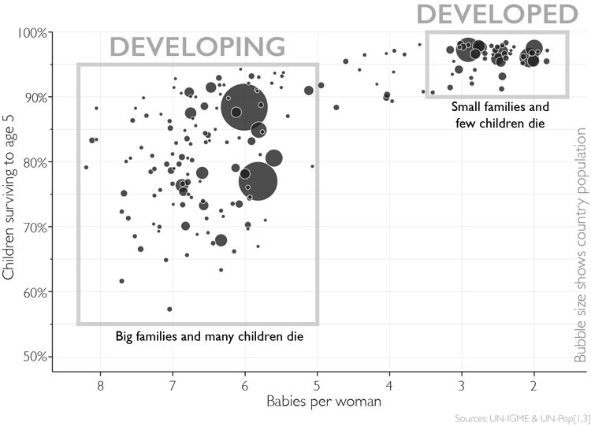
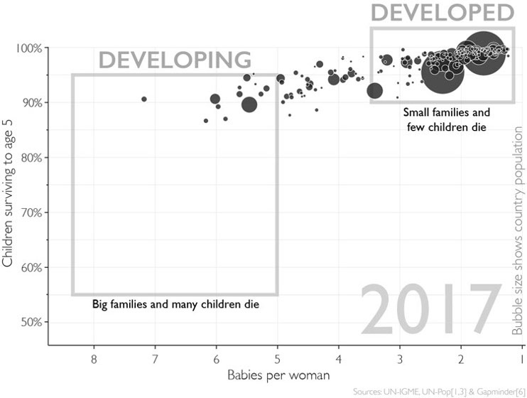

- **Mechanism:** A typology is an empirical claim that a joint distribution has
  separated modes with an empty boundary between them. Freezing the historical
  bounding boxes in coordinate space (`geom_rect`) while updating the data turns
  an empty box into direct visual proof that the taxonomy broke.

#### 2. Three-Step De-Bundling: From Zoomed Means to Zero-Baseline Means to Overlapping Distributions

How do you counter a misleading "gap" claim based on group averages? On pages
42–43, Rosling walks the same two pairs of comparisons—U.S. Men vs. Women SAT
math scores and U.S. vs. Mexico average daily income—through three successive
encodings:

1. **Zoomed group-mean trajectories (p. 42, top):** Standard line charts with
   tight vertical axes (500–540 for SAT math; $6–$67/day for income). Both
   visually scream an unbridgeable chasm.
2. **Zero-baseline / full-range trajectories (p. 42, bottom):** Expanding the
   vertical axis to `[0, 600]` collapses the male–female SAT line gap into
   near-coincidence, while the U.S.–Mexico log-income gap remains wide.
3. **De-bundling means into population-scaled distributions (p. 43):** Collapsing
   time to a single cross-section (`2016`) and replacing the group mean
   $E[Y \mid G]$ with overlapping kernel density curves scaled by headcount. The
   male and female math score distributions overlap almost completely ("the
   majority of women have a male math twin"), and even U.S. and Mexican individual
   incomes overlap across the middle brackets ($8–$32/day).

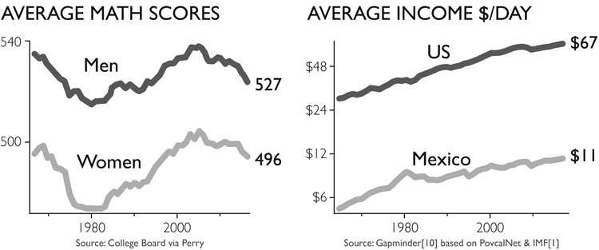
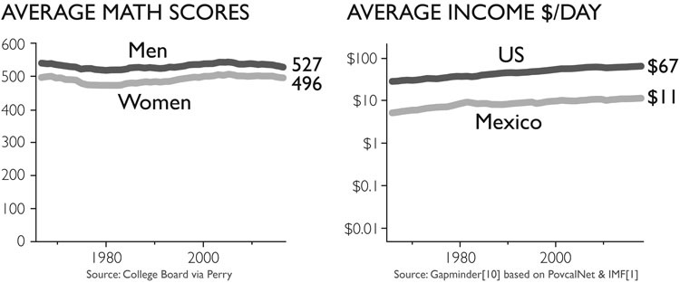
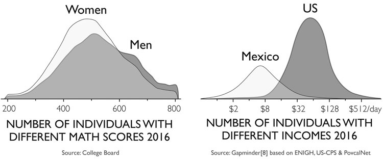

He repeats this move on page 45 for inequality in Brazil: a truncated-axis time
series of the richest 10%'s income share (falling from 50% in 1989 to 41% in 2015) is paired with the 2016 full population income density across Levels 1–4,
with the top 10% shaded directly as the right tail above $32/day.

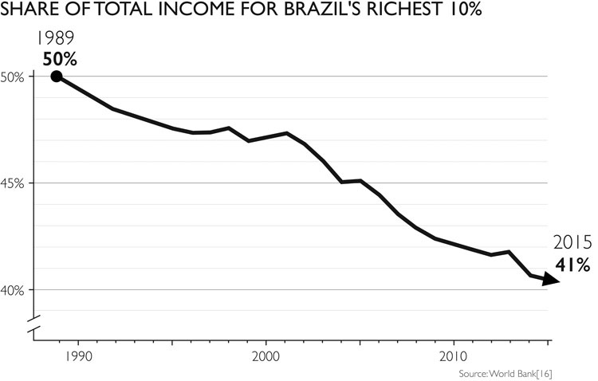
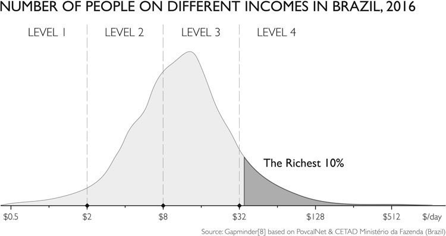

- **Mechanism:** A difference in group means ($\bar{Y}_A - \bar{Y}_B$) says
  nothing about distributional overlap $\int \min(f_A(y), f_B(y))\,dy$ or
  $P(Y_A > Y_B)$. Fixing a truncated vertical axis (as in Cairo's _How Charts
  Lie_) is only half the repair; if the claim is about group separation, the
  mean itself is the wrong summary.

#### 3. The 2D Cut-Plane Audit ("Healthiest of the Poor vs. Poorest of the Healthy")

Any verbal superlative about an observation in a bivariate cloud $(X, Y)$ is
implicitly a conditional statement: are you conditioning on $X$ or conditioning
on $Y$?

On page 180, Rosling plots 1995 _Life expectancy_ against _GDP per capita_ twice
to audit two competing ideological claims about Cuba:

- **Vertical cut-plane (conditioning on $X = \text{Income}$):** Partition the
  horizontal axis into `POOR` and `RICH`. Inside the `POOR` box, Cuba sits at
  the very top ("Cuba — Healthiest of the Poor").
- **Horizontal cut-plane (conditioning on $Y = \text{Lifespan}$):** Partition
  the exact same scatterplot vertically into `SICK` and `HEALTHY`. Inside the
  `HEALTHY` box, Cuba sits at the far left ("Cuba — Poorest of the Healthy").

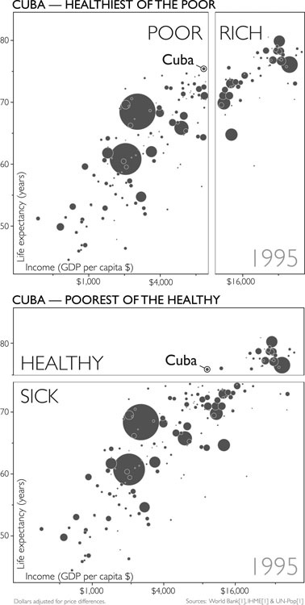

#### 4. Focal-Case Dominance Crosshairs

Instead of arbitrary grid lines or a fitted regression curve, page 182 uses the
**focal observation's own coordinates** $(x_{\text{US}}, y_{\text{US}}) = (17\%,
79\text{ years})$ as reference crosshairs on a scatterplot of _Life expectancy_
versus _Health spending as % of GDP_.

- The crosshairs partition the plane into dominance quadrants: the upper-left
  quadrant $\{x < x_{\text{US}}, y > y_{\text{US}}\}$ (countries that spend less
  and live longer) is colored solid black (39 countries), while countries below
  the 79-year horizontal line are muted to light gray, and the region to the
  right of 17% is empty.

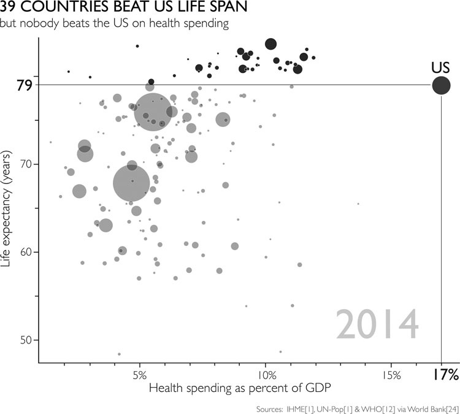

#### 5. Space-Time Trajectory Overlays ("Time-Machine Benchmarks")

Readers have weak intuition for what a log-GDP difference means across countries
today, but strong intuition for their own country's historical past. On page 59,
Rosling plots the 2017 cross-section of countries as a muted gray bubble cloud,
then overlays **Sweden's longitudinal path from 1800 to 2017** as a connected
black trace through the same $(X, Y)$ space, pairing historical Swedish
waypoints with contemporary countries sitting at the same coordinates:

- `Sweden 1891` $\leftrightarrow$ `Lesotho 2017`
- `Sweden 1921` $\leftrightarrow$ `Zambia 2017`
- `Sweden 1948` $\leftrightarrow$ `Egypt 2017`
- `Sweden 1975` $\leftrightarrow$ `Malaysia 2017`

He also draws a hard horizontal threshold at age 50, marking the entire bottom
half of the graph (where Sweden spent 1800–1891) as completely empty of
countries in 2017.

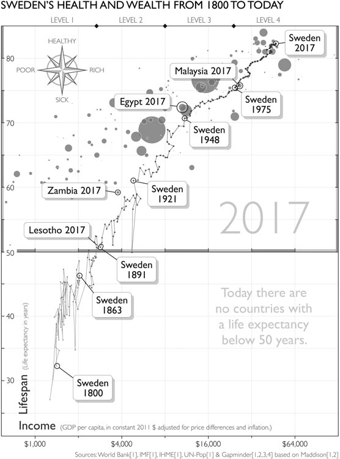

#### 6. Explicit Null-Model Baselines (The Chimp Line & Complement Bars)

Every poll-result bar chart in the book uses a full `0%–100%` horizontal axis
and drops a vertical reference line at `33%` marked with a monkey icon—the
expected accuracy of chimpanzees choosing at random among three answers (A, B,
C).

- **Standard accuracy view (p. 31):** Bars grow left-to-right from `0%`, stopping
  well short of the `33%` monkey benchmark.
- **Complement ("Very Wrong") view (p. 138):** For expert audiences (Davos,
  Nobel laureates, major banks), Rosling flips the bars to grow **right-to-left
  from `100%`**, showing the share picking the _most wrong_ option pushing past
  the monkey line from the right.

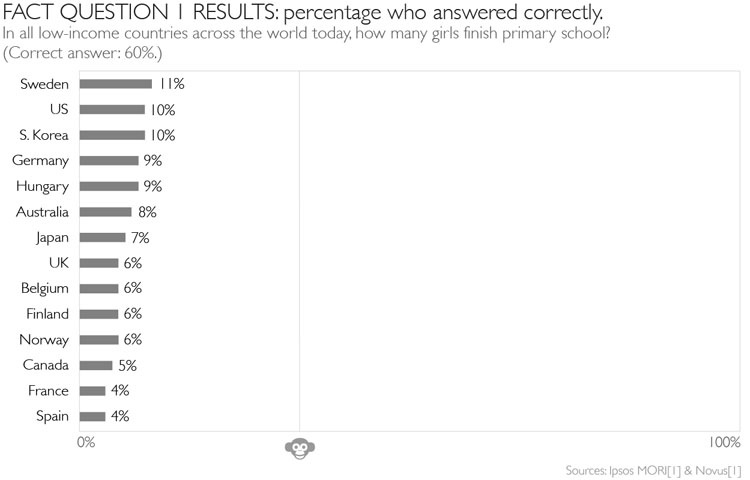
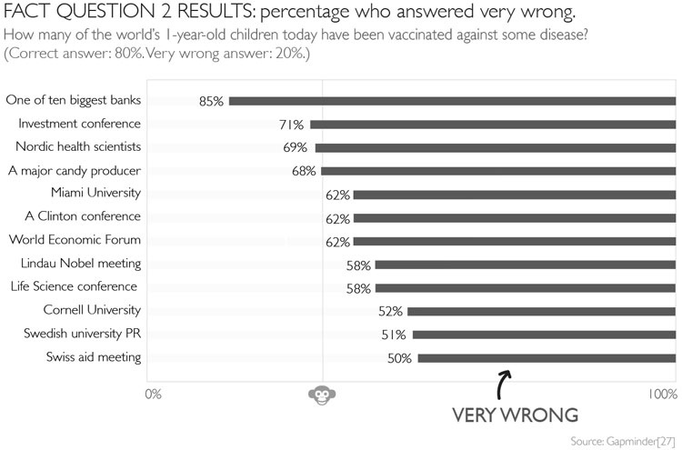

#### 7. A Standardized Base-2 Human Ruler ("Four Income Levels" + Dollar Street)

Logarithmic axes ($10^3, 10^4, 10^5$ GDP per capita) are mathematically natural
for multiplicative growth (p. 94) but cognitively opaque. Rosling replaces raw
log ticks across the entire book with four human-scale brackets defined by
**quadrupling daily income** ($1 \to $2 \to $8 \to $32 \to $64/day):

- **Level 1 (<$2/day, ~1 billion people):** Barefoot or flip-flops, fetching
  water on foot, cooking over an open fire, sleeping on dirt floors.
- **Level 2 ($2–$8/day, ~3 billion people):** Bicycles, plastic sandals, gas
  stoves, thin mattresses, chickens; one illness away from sliding back to
  Level 1.
- **Level 3 ($8–$32/day, ~2 billion people):** Running water, stable
  electricity, fridges, motorcycles, kids finishing high school.
- **Level 4 (>$32/day, ~1 billion people):** Cars, indoor hot/cold water,
  dishwashers, vacation flights, >12 years of schooling.

To prove that income level—not national culture or religion—drives daily living
standards and demographics, he pairs small multiples across the four levels
(p. 163, babies per woman by religion across L1–L4) with **Dollar Street** photo
grids holding income level constant across countries (p. 145, typical beds on
Level 4 across 12 countries).

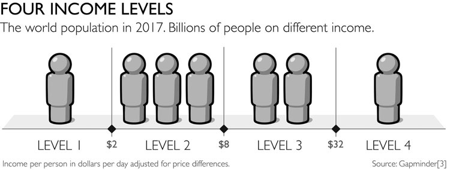
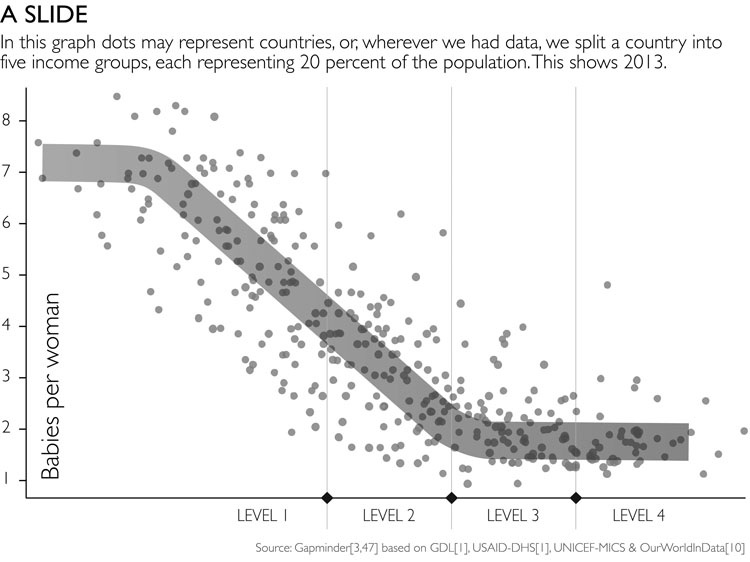
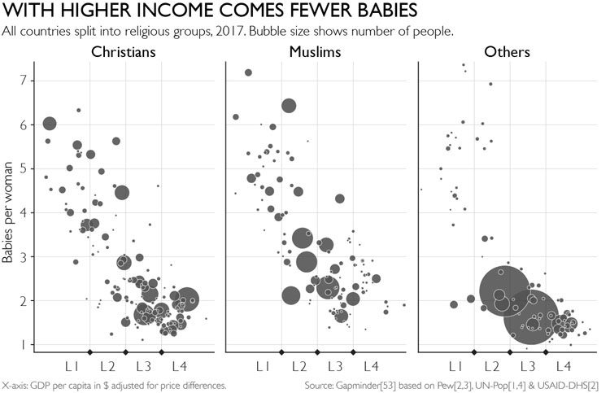
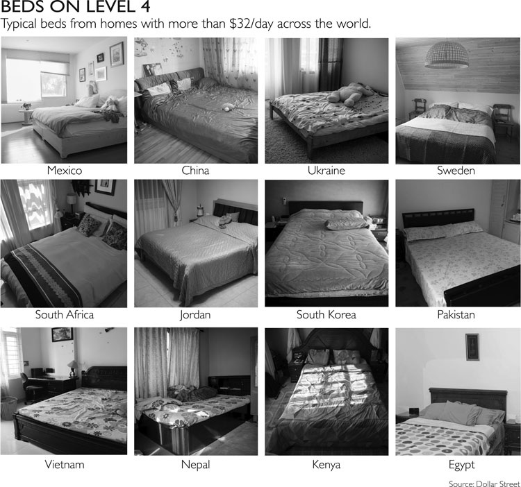

#### 8. Endpoint-Anchored Small Multiples & Perception-vs.-Reality Strips

- **Endpoint-only sparkline grids (p. 62):** In "16 Bad Things Decreasing,"
  Rosling drops vertical axis tick ladders entirely. Each panel highlights only
  the **start/peak year and value** (black dot) and **latest year and value**
  (black arrowhead), letting the area silhouette and endpoint ratio show the
  decline across 16 disparate units.
- **Directional-arrow bridge between stacked time series (p. 69):** Between the
  top series (share of U.S. respondents saying crime went up vs. last year) and
  the bottom series (actual FBI reported crimes), a two-row strip of annual
  arrows (`PERCEPTION: ↗ ↗ ↗ ...` vs. `REALITY: ↘ ↘ ↘ ...`) translates level
  curves into year-over-year directional signs so the mismatch is countable at a
  glance.
- **Bivariate unit-block stacks (pp. 85, 195):** Where total mass is the
  product of two quantities—such as _population by income level_ $\times$
  _per-capita $\text{CO}_2$ emissions_ (p. 195), or _demographic fill-up_ by
  15-year age cohorts over time (p. 85)—Rosling stacks discrete 1-billion-person
  human icons on the baseline and places the per-person output blocks directly
  overhead so the reader sees both the per-capita rate (height) and total global
  share (area = people $\times$ height).

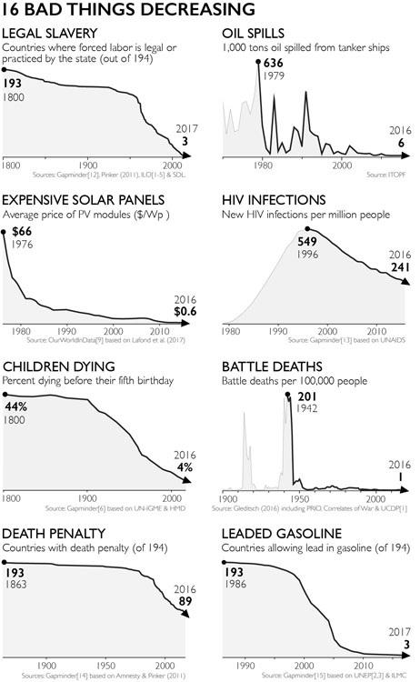
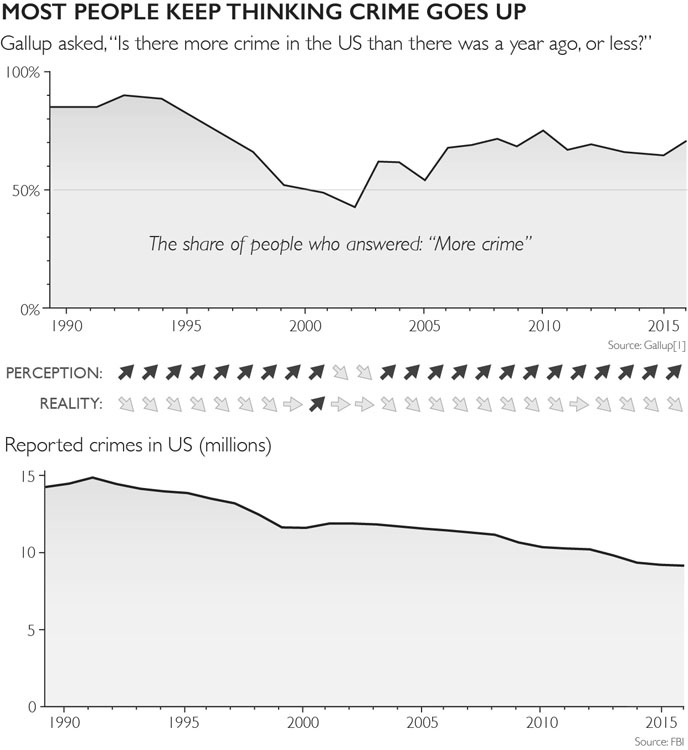
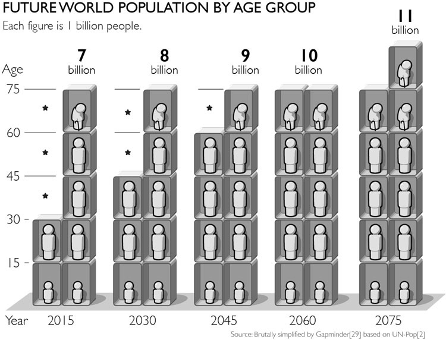
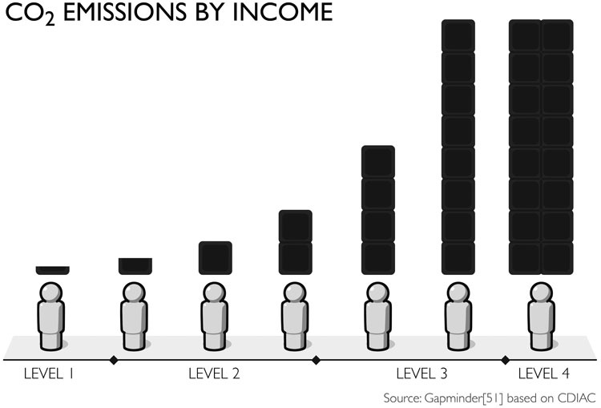

---

### The Ten Dramatic Instincts & Rules of Thumb

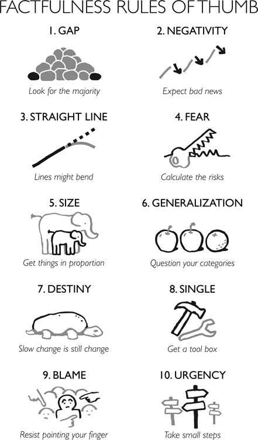

|   # | Instinct               | Cognitive Trap                                                                                                                                         | Factfulness Rule of Thumb                                                                                                                                                     |
| --: | :--------------------- | :----------------------------------------------------------------------------------------------------------------------------------------------------- | :---------------------------------------------------------------------------------------------------------------------------------------------------------------------------- |
|   1 | **Gap**                | Dividing continuous distributions into two warring boxes ("rich vs. poor," "us vs. them") by comparing averages or extremes.                           | **Look for the majority.** Check where the middle 75% sits; ask for the full distribution and overlap, not just group means.                                                  |
|   2 | **Negativity**         | Mistaking increased news coverage of bad events + nostalgic rose-tinting of the past for a deteriorating world.                                        | **Expect bad news.** Remember that "bad" (current level) and "getting better" (trend direction) can be true simultaneously.                                                   |
|   3 | **Straight Line**      | Assuming trends continue linearly forever (e.g., world population growing indefinitely when total children aged 0–14 already plateaued at ~2 billion). | **Lines might bend.** Distinguish linear, doubling (exponential), S-curve, and hump/slide shapes.                                                                             |
|   4 | **Fear**               | Confusing _frightening_ with _dangerous_ (natural disasters, plane crashes, terrorism, nuclear/chemical scares account for <1% of global deaths).      | **Calculate the risks.** $\text{Risk} = \text{Danger} \times \text{Exposure}$. Never act while afraid.                                                                        |
|   5 | **Size**               | Letting a large lonely number ("4.2 million babies died last year") induce misproportion without a baseline or denominator.                            | **Get things in proportion.** Always demand a comparison (historical baseline) and a rate (divide by the relevant population). Use the 80/20 rule on budgets and causes.      |
|   6 | **Generalization**     | Treating all members of a category ("developing countries," "Africans," "religions") as homogeneous, or generalizing from vivid outliers.              | **Question your categories.** Look for differences _within_ groups and similarities _across_ groups (e.g., across Income Levels 1–4). Beware of "the majority" (51% vs. 99%). |
|   7 | **Destiny**            | Believing that innate cultural, religious, or national traits lock societies into permanent demographic or economic stagnation.                        | **Slow change is still change.** Track 1%–3% annual compound changes over decades; compare current societies to your own grandparents' era.                                   |
|   8 | **Single Perspective** | Relying on one ideological hammer, single metric (like GDP or average lifespan), or narrow domain expert.                                              | **Get a toolbox.** Test favorite ideas against disconfirming cases (e.g., Cuba vs. the U.S. on health and wealth); welcome numbers but know their limits.                     |
|   9 | **Blame**              | Hunting for a single villain (greedy CEOs, foreign governments, bad journalists) whenever something goes wrong.                                        | **Resist pointing your finger.** Look for interlocking systems and incentives rather than bad individuals; credit institutions rather than heroes when things go right.       |
|  10 | **Urgency**            | "Now or never" alarmism that shuts down analytical thought and demands drastic action without data.                                                    | **Take small steps.** Ask for data and uncertainty intervals; beware of worst-case predictions and side effects of drastic interventions.                                     |
